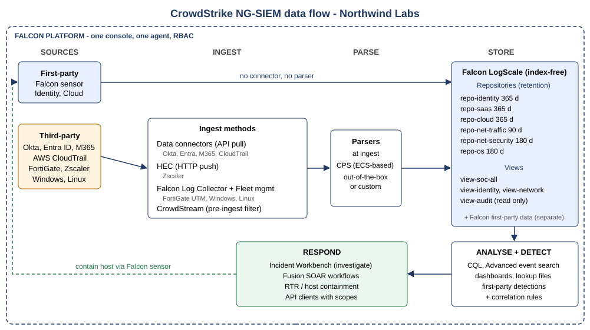

# 01 - Architecture

Part of the [NG-SIEM lab](../README.md). Reference architecture for a CrowdStrike Falcon Next-Gen SIEM (NG-SIEM) deployment: data flow, sizing, retention and repository design, role-based access control, naming and tagging, and the decisions behind them.

The design is built for a **fictional organisation, Northwind Labs** (500 users, 300 endpoints). Every number is a planning value, so no real tenant data appears anywhere in this project.



## Goal

Show how to design an NG-SIEM deployment before onboarding any data: where logs come from, how they are ingested, parsed and stored, how long they are kept, who can see and change what, and how the design is sized against licensing.

## Design at a glance

| Item | Design |
|---|---|
| Third-party sources | 9 (Okta, Entra ID, Microsoft 365, AWS CloudTrail, FortiGate x2, Zscaler, Windows DCs, Linux) |
| Ingest methods | Data connectors, HEC, Falcon Log Collector, CrowdStream |
| Average / peak EPS | 204 / 612 |
| Ingest after filtering (estimate) | 8.03 GB/day (raw 11.53, filtering saves 3.50) |
| With 25% growth buffer (estimate) | 10.03 GB/day, which is 0.03 GB/day above the 10 GB/day free tier in the study notes |
| Repositories | 6, split only by retention and access |
| Retention | 365 days (identity, SaaS, cloud), 180 days (OS, network security), 90 days (network traffic) |
| Containment | Endpoint correlation, 2+ independent signals, L2 approval, exclusions, rate limit (ADR-009) |
| Roles | Read-only analyst, analyst, administrator, Falcon administrator, plus a scoped API client for automation |

## Contents

| Path | What it covers |
|---|---|
| [`docs/01-overview-and-scope.md`](docs/01-overview-and-scope.md) | Environment, use cases, scope boundaries |
| [`docs/02-data-flow.md`](docs/02-data-flow.md) | End-to-end flow, ingest path per source, time fields, no re-parsing constraint |
| [`docs/03-sizing.md`](docs/03-sizing.md) | Sizing method, results, sensitivity, collector capacity |
| [`docs/04-retention-and-repositories.md`](docs/04-retention-and-repositories.md) | Repository and view design, retention rationale, datasource limits |
| [`docs/05-rbac.md`](docs/05-rbac.md) | Roles, personas, separation of duties |
| [`docs/06-naming-and-tagging.md`](docs/06-naming-and-tagging.md) | Platform tag schema and project naming conventions |
| [`docs/07-decisions-adr.md`](docs/07-decisions-adr.md) | Nine architecture decision records, including containment guardrails |
| [`docs/08-rbac-verification.md`](docs/08-rbac-verification.md) | RBAC verification procedure, riskiest assumptions and fallbacks |
| [`config/rbac-matrix.csv`](config/rbac-matrix.csv) | Capability-by-role matrix (design intent, not yet verified) |
| [`config/rbac-console-mapping.csv`](config/rbac-console-mapping.csv) | Worksheet for mapping each capability to a real console permission |
| [`config/containment-policy.json`](config/containment-policy.json) | Machine-readable guardrails for automated host containment |
| [`sample-data/sizing-calculator.xlsx`](sample-data/sizing-calculator.xlsx) | Formula-driven sizing workbook |
| [`docs/diagrams/`](docs/diagrams) | Data flow diagram (SVG and PNG) |

## Using the sizing calculator

1. Open `sample-data/sizing-calculator.xlsx`.
2. On **Assumptions**, review the yellow cells (compression, growth, peak multiplier, free tier).
3. On **Sizing**, edit the blue cells for each source: EPS, event size, filter reduction, retention.
4. Read the result on **Summary**. Everything recalculates from the inputs.

## Validation

The workbook is the source of truth for every number in the docs. `tests/test_consistency.py` fails if a document drifts from it, if a repository is given two retention periods, if the RBAC matrix breaks a separation-of-duties rule, or if a secret-like value, broken link or unknown repository name appears.

```bash
pip install -r ../requirements-dev.txt
pytest -q
```

GitHub Actions (`.github/workflows/validate.yml`) runs the same suite on every push and pull request, plus Markdown lint, an offline link check and a render check of every Mermaid diagram. After editing the workbook, recalculate it before committing so cached values are present; the tests read those cached values. Run `pytest -q` from inside this folder.

## Verify before relying on this design

Licensing, limits and role names vary by contract and change over time. Check these against current CrowdStrike documentation and your own licence:

- [ ] Free third-party ingest allowance (10 GB/day) and its 7-day retention
- [ ] Maximum retention for third-party data under your licence (the notes record 365 days as a generic LogScale ceiling)
- [ ] Exact built-in NG-SIEM role names and permissions, including whether an "NG SIEM Security Lead" role exists. Complete `config/rbac-console-mapping.csv` (procedure in `docs/08-rbac-verification.md`)
- [ ] Compression ratio and filter reductions replaced by measured values (validation plan in `docs/03-sizing.md`)
- [ ] How repository and view level data access is configured in the NG-SIEM console
- [ ] Current allowed values for `#observer.type`
- [ ] CrowdStream availability under your licence
- [ ] Names of the Falcon response roles used for RTR and containment

## Related projects

See the module index in the [root README](../README.md). Modules 02 onward reuse this module's sources, repositories, tags and roles.

## Security notes

No tokens, customer IDs, tenant names, real IPs or hostnames are included. The `.gitignore` excludes common local secret and tenant files; it does not protect already tracked files. Keep it that way when adapting this project to a real environment.
