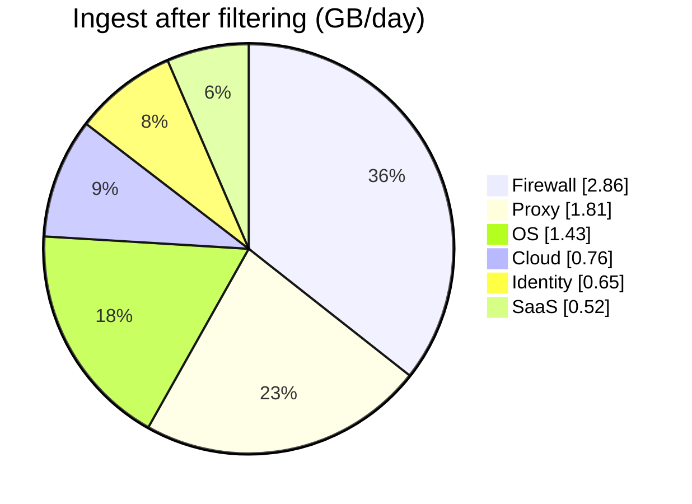

# 03 - Sizing

All figures below are produced by `../sample-data/sizing-calculator.xlsx`. Change the blue input cells there and the Summary sheet recalculates. EPS and event sizes are fictional planning values for Northwind Labs.

## Method

```text
Raw GB/day      = Avg EPS x Avg event size (bytes) x 86,400 / 1,000,000,000
Ingest GB/day   = Raw GB/day x (1 - pre-ingest filter reduction)
Stored GB       = Ingest GB/day x Retention (days) / Compression ratio
Planning figure = Ingest GB/day x (1 + growth buffer)
```

Only **third-party** data is sized. First-party Falcon data is already in the platform and is not counted here.

## Assumptions

| Parameter | Value | Status |
|---|---|---|
| Compression ratio (raw : stored) | 10 : 1 | Assumption. Measure from repository stats after onboarding. |
| Growth buffer (12 months) | 25% | Assumption (new sources and organisational growth) |
| Peak-to-average EPS multiplier | 3x | Assumption, used only for collector/HEC capacity |
| Free third-party ingest | 10 GB/day | From study notes for Falcon Insight XDR customers. **VERIFY** against current licensing. |

## Results

| Metric | Value |
|---|---|
| Third-party sources | 9 |
| Average EPS | 204 |
| Peak EPS (3x) | 612 |
| Raw ingest | 11.53 GB/day |
| Saved by pre-ingest filtering | 3.50 GB/day (about 30%) |
| **Ingest after filtering** | **8.03 GB/day** |
| Ingest including 25% growth | 10.03 GB/day |
| Free tier | 10 GB/day |
| Headroom today | +1.97 GB/day |
| Headroom with growth | -0.03 GB/day |
| Stored data at steady state | about 142 GB |

## Ingest by category (after filtering)

| Category | GB/day | Share |
|---|---|---|
| Firewall | 2.86 | 36% |
| Proxy | 1.81 | 23% |
| OS | 1.43 | 18% |
| Cloud | 0.76 | 9% |
| Identity | 0.65 | 8% |
| SaaS | 0.52 | 6% |
| **Total** | **8.03** | **100%** |



Network sources (firewall plus proxy) are about 59% of ingest from only 3 of the 9 sources. That is where filtering effort pays off.

## Key finding

Today the design fits inside the 10 GB/day free tier with about 2 GB/day to spare. With the 25% growth buffer it reaches 10.03 GB/day, which is **0.03 GB/day over**. The design decision (see ADR-007 in `07-decisions-adr.md`) is to treat the free tier as a planning boundary, tighten filters before growth arrives, and confirm licensed volume if the boundary is crossed.

## Sensitivity: what moves the number most

| Change | Effect on ingest |
|---|---|
| FortiGate traffic filter reduction 50% to 40% | +0.48 GB/day |
| FortiGate traffic filter reduction 50% to 60% | -0.48 GB/day |
| Enabling CloudTrail data events | Not modelled. Can multiply CloudTrail volume. Keep excluded unless a use case requires it. |
| Adding a new SaaS source | Typically small, model it before onboarding |

## Collector and HEC capacity

Peak load is about 612 EPS across all sources, spread over several collectors and API connectors. This is low for any single collector. The design still uses **two Falcon Log Collector instances** for availability rather than for throughput, so a collector restart does not create a collection gap. Benchmark real collector throughput in your own environment; no vendor throughput figures are asserted here.

## Retained storage by repository

| Repository | Ingest GB/day | Retention (days) | Stored GB (steady state) |
|---|---|---|---|
| repo-identity | 0.648 | 365 | 23.7 |
| repo-saas | 0.518 | 365 | 18.9 |
| repo-cloud | 0.760 | 365 | 27.8 |
| repo-net-traffic | 4.190 | 90 | 37.7 |
| repo-net-security | 0.484 | 180 | 8.7 |
| repo-os | 1.426 | 180 | 25.7 |
| **Total** | **8.027** | | **142.4** |

Storage capacity itself is governed by licence on the platform, so stored GB is shown to understand the shape of retention cost, not to provision disks.
