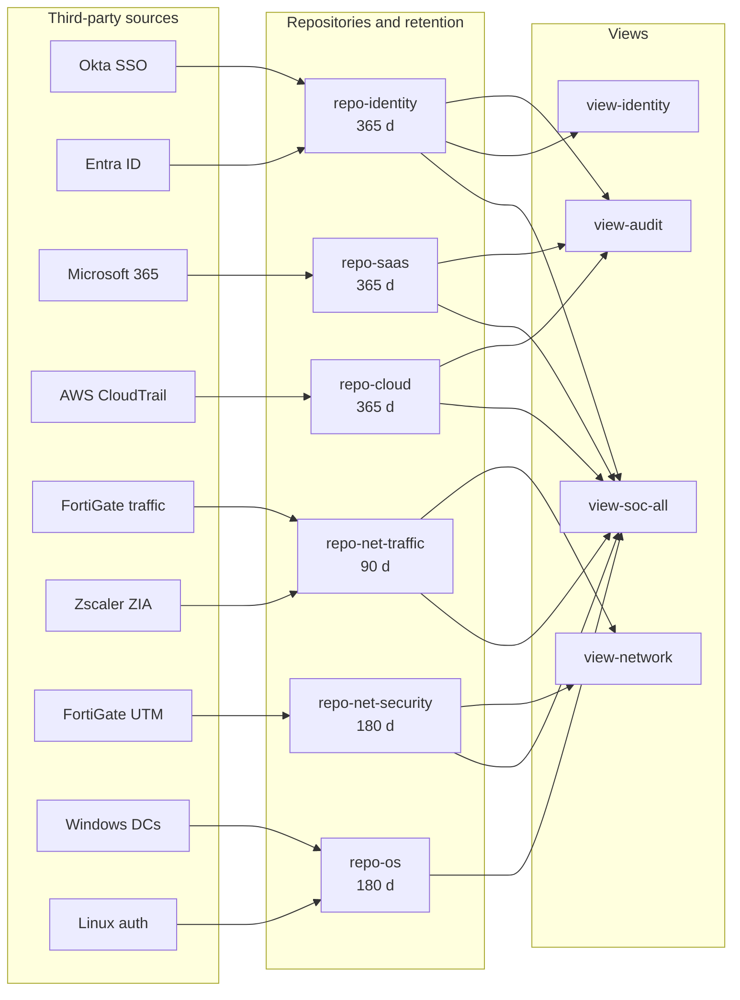

# 04 - Retention and repositories

## How retention works (platform facts)

- Retention is set **per repository**, so data that needs different retention must live in different repositories.
- A repository has three limits: ingest size (GB), storage size (GB) and age (days). Data is deleted as soon as **any one** limit is reached, oldest first, one whole segment at a time.
- The licence sets the maximum. The study notes record 365 days as the LogScale Cloud default ceiling unless more is arranged with support. **VERIFY**: NG-SIEM retention is licence-defined, so confirm the maximum for your contract.
- A view lets you search several repositories at once. It is a window across repositories, not a copy of the data.
- Falcon first-party data is kept separately from third-party data, and its retention follows the Falcon licence rather than the design below.

## Design principle

Split repositories along two lines only:

1. **Retention period**: sources that need different retention cannot share a repository.
2. **Access boundary**: data that some roles must not see goes in its own repository.

Everything else is handled with tags inside a repository. Over-splitting makes cross-source searches harder and adds administration.

## Repositories

| Repository | Sources | Retention | Reason |
|---|---|---|---|
| `repo-identity` | Okta SSO, Entra ID | 365 days | Account compromise is often discovered months later; identity logs are small and high value |
| `repo-saas` | Microsoft 365 audit | 365 days | Business email compromise and data access investigations need long lookback; low volume |
| `repo-cloud` | AWS CloudTrail | 365 days | Control-plane history is needed for cloud incident reconstruction; low volume with data events excluded |
| `repo-net-traffic` | FortiGate traffic, Zscaler ZIA | 90 days | Highest volume and lowest long-term value per GB; 90 days covers most investigations |
| `repo-net-security` | FortiGate UTM/event | 180 days | IPS, VPN and admin events are low volume and worth keeping longer than raw traffic |
| `repo-os` | Windows Security (DCs), Linux auth | 180 days | Authentication history for lateral movement and persistence investigations |

The retention values are design decisions for this fictional organisation. Replace them with your own compliance and investigation requirements. Example drivers to reference: audit expectations, cyber-insurance questionnaires, and typical attacker dwell time.

## Views

| View | Contains | Intended users |
|---|---|---|
| `view-soc-all` | All six repositories | SOC analysts, detection engineers |
| `view-identity` | `repo-identity` | Identity team, helpdesk escalation |
| `view-network` | `repo-net-traffic`, `repo-net-security` | Network team |
| `view-audit` | `repo-identity`, `repo-saas`, `repo-cloud` | Auditors (read only) |

**VERIFY** how repository and view level data access is exposed in the NG-SIEM console for your tenant, since it may differ from generic LogScale documentation.

## Tiering and search cost

Recent data sits on fast local disk and older data in object storage, so a 365-day identity hunt is slower than a 7-day one. Guidance for analysts:

- Start with the shortest time range that can answer the question.
- Filter on tags first (`#Vendor`, `#event.module`), then on fields.
- Use `view-soc-all` for cross-source correlation and a single-source view for deep history.

## Datasource limits to respect

Each unique combination of tag values forms a datasource. From the study notes (LogScale documentation):

| Rule | Value |
|---|---|
| Maximum datasources per repository (default) | 10,000 |
| Avoid tags with more than | about 1,000 distinct values |
| If a tag needs more values | Use tag groupings, which hash values into a fixed number of buckets |

Design consequence: never use a high-cardinality field such as a username, IP address or session ID as a tag.

## Retention review cadence

| Trigger | Action |
|---|---|
| Quarterly | Compare actual ingest per repository against `sizing-calculator.xlsx` |
| New source onboarded | Assign it to an existing repository or justify a new one in an ADR |
| Compliance change | Update retention and record the reason in `07-decisions-adr.md` |
