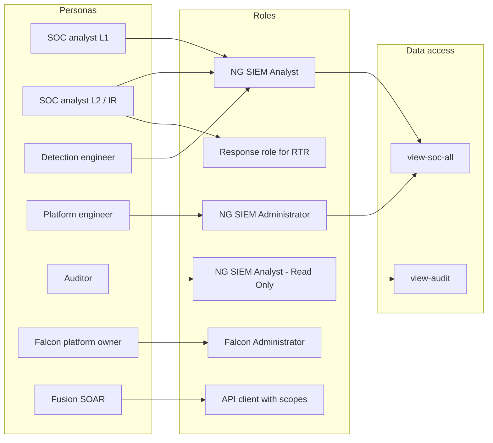

# 05 - Role-based access control

The full permission matrix is in `../config/rbac-matrix.csv`. This document explains the design reasoning. Day-to-day user administration (provisioning, SSO, API clients, access reviews) is module 02 (user management).

## Principles

1. **Least privilege**: start with the lowest built-in role that lets a person do their job.
2. **Separate duties**: the people who build detections should not be the only people who can change ingestion or retention.
3. **Few administrators**: administrators are a small group; day-to-day work uses lower roles.
4. **Containment is a separate permission**: reading an alert and isolating a host are different powers and are granted separately.
5. **Automation uses API clients with minimal scopes**, never a person's account.

## Built-in role ladder (from study notes)

| Role | Purpose |
|---|---|
| NG SIEM Analyst - Read Only | View data and cases, change nothing |
| NG SIEM Analyst | Investigate, triage, build their own correlation rules |
| NG SIEM Administrator | Full NG-SIEM administration: connectors, parsers, rules, settings |
| Falcon Administrator | Whole Falcon platform: users, API clients, everything |

The study notes also mention a possible "NG SIEM Security Lead" role from exam preparation material. **VERIFY** whether it exists in the current console before using it. Exact role names and permissions change over time, so confirm each one in your tenant.

## Personas mapped to roles

| Persona (Northwind Labs) | Headcount | Role assignment | Notes |
|---|---|---|---|
| SOC Analyst L1 | 4 | NG SIEM Analyst | Triage and investigate. No ingest or parser changes. |
| SOC Analyst L2 / Incident responder | 2 | NG SIEM Analyst, plus a response role for RTR/containment | Containment role granted separately. **VERIFY** the exact Falcon response role names. |
| Detection engineer | 2 | NG SIEM Analyst, plus rule-management permissions via a custom role if available | Builds and tunes correlation rules. Changes go through CI review (see module 06). |
| Platform engineer | 2 | NG SIEM Administrator | Owns connectors, HEC tokens, parsers, repositories, retention. |
| Auditor / compliance | 1 | NG SIEM Analyst - Read Only | Uses `view-audit` only. |
| Falcon platform owner | 1 | Falcon Administrator | Break-glass and user management. Not used for daily work. |
| Automation (Fusion, scripts) | n/a | API client with named scopes | One client per integration, scopes limited to what it calls. |

## Separation of duties in practice

| Risk | Control |
|---|---|
| An analyst disables a noisy rule to close their queue | Analysts cannot edit rules they did not create; rule changes require a detection engineer |
| A parser change silently breaks detections | Only platform engineers change parsers, and each change is tested against sample data first |
| Retention shortened to hide activity | Retention is administrator-only and changes are recorded as ADRs |
| One account does everything | Falcon Administrator is held by one named person, with a second in reserve, and is not used for daily work |
| A leaked automation credential | One API client per integration, minimal scopes, stored in a secrets manager, rotated on a schedule |

## Data access

Role permissions control what a person can do. Which repositories and views they can search is a separate control. The intended data access is in `04-retention-and-repositories.md`:

- SOC roles search `view-soc-all`.
- Auditors search `view-audit` only.
- Identity and network teams get their scoped views if they need direct access.

## Review

| Cadence | Activity |
|---|---|
| Joiner / mover / leaver | Update role assignment the same day |
| Quarterly | Review all administrator and containment assignments |
| Quarterly | Review API clients and their scopes; remove unused ones |
