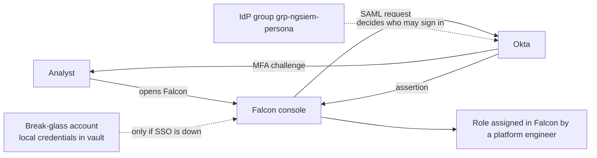

# 02 - Authentication and SSO

## Design

All named users sign in to Falcon through SAML single sign-on with Okta as the identity provider. Okta enforces MFA. Local Falcon credentials exist only for two break-glass accounts.

## Requirements

| # | Requirement | Reason |
|---|---|---|
| R1 | SSO is mandatory for every named user | One place to enforce MFA, offboarding and session policy |
| R2 | MFA is enforced at the IdP for the Falcon application | Falcon trusts the IdP's assertion, so the IdP is the control |
| R3 | Privileged personas use phishing-resistant MFA (FIDO2 or equivalent) | Privileged accounts are the main target of MFA fatigue and real-time phishing |
| R4 | Only members of `grp-ngsiem-<persona>` can reach the Falcon application in Okta | The group is the access request boundary |
| R5 | IdP group membership changes are logged, alerted and reviewed | Group membership is access (see below) |
| R6 | Break-glass accounts are local, excluded from SSO, sealed and tested every 90 days | SSO outage must not lock the SOC out of its own tools |
| R7 | Session lifetime and inactivity timeout are set as short as the SOC can tolerate | Limits the value of a stolen session |

## The IdP is part of the attack surface

Whoever controls Okta controls who can sign in to the SIEM. An attacker who can add themselves to `grp-ngsiem-platform-engineer` has a path to the platform that never touches Falcon. The design therefore:

- uses phishing-resistant MFA for the Okta administrators who can change those groups (R3 applies to them as well);
- ingests Okta logs into `repo-identity` (module 01), so changes to the Falcon application assignment, to the groups and to MFA policy are searchable and alertable in the SIEM itself;
- treats those events as high severity (see `06-audit-and-monitoring.md`).

## Break-glass accounts

| Property | Design |
|---|---|
| Number | 2 (`nw-bg-01`, `nw-bg-02`) |
| Role | Falcon Administrator |
| Credentials | Long random passwords, split between two custodians, sealed in the vault with physical backup. Never used for normal work. |
| Use | Only when SSO is unavailable or the IdP is compromised, approved by the CISO or on-call security lead |
| Detection | Any sign-in by a break-glass account pages the on-call engineer |
| Test | Sign in every 90 days, record the date in the register (`last_tested`), then rotate the password |
| After use | Rotate the password, write an incident record, review everything the account did |

The review tool raises an error when a break-glass test is overdue.

## IdP outage runbook

1. Confirm the outage is the IdP and not Falcon (check Okta status and a second application).
2. The on-call security lead authorises break-glass use and records the reason.
3. Use one break-glass account. Do not hand it to the rest of the SOC.
4. Perform only the actions needed to keep detection and response running.
5. When SSO returns, rotate the break-glass password, close the incident and review the account's activity.

## To verify against your tenant

These depend on your CrowdStrike tenant and licence and are **VERIFY** items:

- SSO enforcement for all users and whether local sign-in remains possible for the break-glass accounts when it is enforced. If local sign-in is disabled, the fallback is an emergency identity in Okta excluded from conditional access, monitored as above.
- Whether roles can be assigned from IdP attributes. Until verified, roles are assigned in the console by a platform engineer (ADR-002).
- Session lifetime and inactivity settings and who can change them.
- Whether MFA requirements can be scoped to the Falcon application only, and per group.
