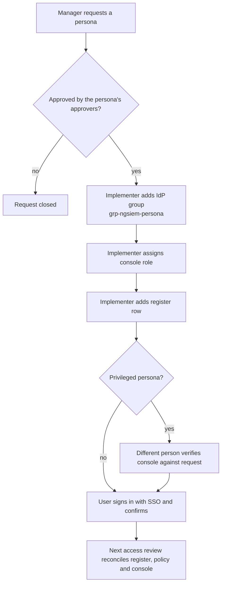

# 03 - Joiner, mover, leaver

Targets come from `../config/role-assignment-policy.json`.

| Event | Target |
|---|---|
| Joiner | Access in place within 2 business days of an approved request |
| Mover | New access granted and old access removed in the same change |
| Leaver | Account disabled within 4 hours of the HR notification |
| Contractor | End date is mandatory when the account is created |

## Roles in the process

| Role | Who | Does |
|---|---|---|
| Requester | The user's manager | Raises the request, names the persona |
| Approver | From the persona's approver list (`01-user-model.md`) | Approves or rejects |
| Implementer | A platform engineer | Adds the IdP group membership, assigns the console role, updates the register |
| Verifier | Someone other than the implementer, for privileged personas | Checks the console against the request |

For privileged personas the requester, approver and implementer must be three different people. The implementer cannot approve their own access.

## Joiner

| Step | Owner | Evidence |
|---|---|---|
| 1. Request names a persona, not a role | Requester | Ticket |
| 2. Approval by the persona's approvers | Approver | Ticket comment |
| 3. Add the user to `grp-ngsiem-<persona>` in Okta | Implementer | IdP log entry |
| 4. Assign the console role for the persona | Implementer | Console audit entry |
| 5. Add the register row with start date, SSO group and next review date | Implementer | Register commit |
| 6. User signs in with SSO and confirms access | User | Ticket comment |
| 7. Verifier compares the console with the request (privileged only) | Verifier | Ticket comment |

New users start at the lowest role that fits the persona. Responders receive the containment role in a second, separate request after training.

## Mover

A person changing team does not accumulate access.

1. Request names the **new** persona and states the **old** one is being removed.
2. Approval from the new persona's approvers.
3. In one change: add the new IdP group, remove the old one, replace the console role, update the register row.
4. The register `persona`, `matrix_role` and `sso_group` change together. A user whose role does not match their persona is error `U02` in the review.

## Leaver

| Step | Owner | Target |
|---|---|---|
| 1. HR notifies the platform team | HR | Day of departure or earlier |
| 2. Remove the user from `grp-ngsiem-*` in Okta and disable the console account | Implementer | 4 hours from notice |
| 3. Mark the register row `disabled` and set `end_date` | Implementer | Same change |
| 4. Revoke any API client the user owned, or move ownership | Implementer | Same day |
| 5. Check the console export: the user must be absent or disabled | Verifier | Next access review at the latest |

Privileged leavers also trigger rotation of anything they could read: break-glass passwords if they were custodians, and the secrets of API clients they owned.

Review findings that catch failures here: `U04` (account active past its end date), `C04` (disabled in the register but present in the console) and `C01` (console account the register does not know about).

## Emergency access

Short-term elevated access, for example an incident needing platform administration, follows the same request but with a time limit:

- approval by the security lead (or CISO for Falcon Administrator) before the access is granted, recorded afterwards if unreachable;
- an automatic expiry date in the ticket, not more than 24 hours;
- removal on expiry and a register entry showing both the grant and the removal;
- no emergency access for containment: that is already held by L2 responders.

## Evidence

Keep for the audit period: the ticket with approvals, the IdP and console audit entries, and the register commit. In this repository the register history in Git is the change record for the register itself.
