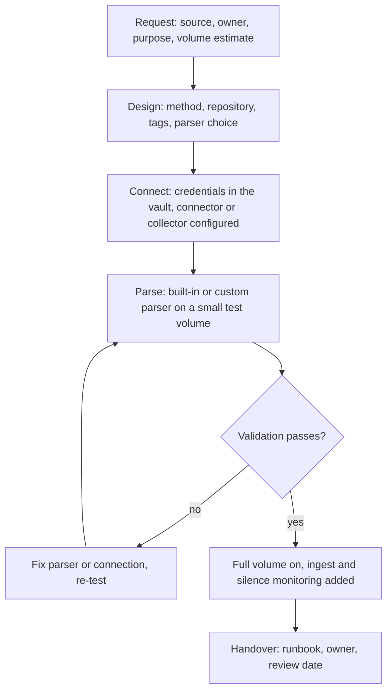

# 01 - Onboarding methods and lifecycle

## Choosing a method

| Method | Direction | Use when | Watch for |
|---|---|---|---|
| Data connector (API pull) | NG-SIEM pulls from the vendor | SaaS, cloud and identity sources with a supported API: Okta, Entra ID, Microsoft 365, AWS CloudTrail | API credentials expire; vendor rate limits; poll delay adds latency |
| HEC (HTTP Event Collector) | Source or relay pushes | The product can send over HTTPS, or a pipeline tool forwards to it: Zscaler | Token handling; sender retries and duplicates; no built-in source health |
| Falcon Log Collector | Agent on the customer network | Syslog, Windows Event Log and files: FortiGate, domain controllers, Linux servers | Needs a host and a fleet to manage (module 04) |
| CrowdStream / Cribl Stream | Pipeline between source and NG-SIEM | High volume needing filtering, routing or reshaping before ingest: FortiGate traffic | One more system to run; reshaping must match what the parser expects |

Module 01 assigns a method to every Northwind source (`01-architecture/docs/02-data-flow.md`). Change a source's method there first, then here.

## Parsers

Use the built-in parser when one exists for the product. Write a custom parser only when none does or when it drops fields you need.

- Parsing happens at ingest. Data already stored is not re-parsed, so a wrong parser costs the data ingested while it was wrong. Validate with a small volume first.
- A parser sets the tag fields module 01 defines (`#Vendor`, `#event.module`, `#event.dataset`, `#observer.type`, `#ecs.version`, `#Cps.version`). Tags are never high-cardinality fields such as host or user.
- A parser that does not match should flag the event, not drop it. See `03-parser-walkthrough.md`.

## Where test data may go

Synthetic or test data (Cribl Datagen, replayed samples) is ingested only into a sandbox or lab tenant. It must never reach a `repo-*` repository from module 01: it would pollute detections, dashboards and retention. `config/parsers/*.meta.json` carries `production_repositories_allowed` and a test enforces it for the test parser.

## Lifecycle

## Definition of done

A source is onboarded only when all of these are true. Each has a place in the evidence kept for the source.

| Check | How it is shown |
|---|---|
| Method and repository match module 01 | Source row in `01-architecture/docs/02-data-flow.md` |
| Credentials held in the vault, not in a file or screenshot | Vault reference in the runbook |
| Events arrive | Validation query returns rows in the last 15 minutes |
| Timestamps correct | `@timestamp` within minutes of `@ingesttimestamp` for live data |
| Key fields populated | Population query: expected percentage per field, listed in the source's runbook |
| No parse failures | No `@error:true`, no `error.message` events above the agreed threshold |
| Tags set and in the module 01 list | Tag query returns the expected values only |
| Volume close to the estimate | Measured GB/day recorded against the sizing workbook, replacing the estimate |
| Silence alert exists | Module 04 alert for the source |
| Owner and review date recorded | Runbook header |
