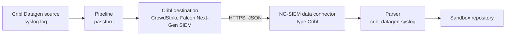

# 02 - Cribl Stream to NG-SIEM with Quick Connect

Runbook for sending a Cribl Datagen test feed through Cribl Stream into NG-SIEM. It was run in a lab environment with synthetic data; the same steps apply to a real source by replacing the Datagen source. Console and Cribl menu names change between versions, so treat label names as guides and **VERIFY** them against the versions you run.

Placeholders used below: `<CONNECTION_ID>`, `<API_URL>`, `<API_KEY>`, `<WORKER_GROUP>`. None of these values belongs in this repository, in a screenshot or in a ticket. The API key goes straight from the NG-SIEM console into the Cribl secret field and the vault.

## Flow

## Prerequisites

- A sandbox or lab NG-SIEM tenant (see `01-onboarding-methods.md`, "Where test data may go").
- Permission to create data connectors, held by the platform role in module 02.
- A Cribl Stream deployment with a worker group you can commit and deploy to.
- A place in the vault for the API key.

## Steps

| # | Where | Action | Result |
|---|---|---|---|
| 1 | NG-SIEM console | Create a data connector of the Cribl type. Name it for the source and environment, not a person. | The console shows `<API_URL>` and issues `<API_KEY>` once |
| 2 | NG-SIEM console | Copy the API key into the vault immediately. Record the connection ID in the runbook as `<CONNECTION_ID>` only in the private copy. | Key is not shown again |
| 3 | NG-SIEM console | Install the parser `config/parsers/cribl-datagen-syslog.cql` and set its tag fields from `cribl-datagen-syslog.meta.json`. | Parser exists before data does |
| 4 | Cribl | Add a Datagen source using the `syslog.log` sample. | Synthetic RFC3164 lines |
| 5 | Cribl | Create or select a pipeline with no functions (passthru). | Events pass unchanged |
| 6 | Cribl | Add the CrowdStrike Falcon Next-Gen SIEM destination: `<API_URL>`, request format JSON, authentication manual with `<API_KEY>`, backpressure behaviour block. | Destination configured |
| 7 | Cribl | Connect source, pipeline and destination with Quick Connect. | Route drawn |
| 8 | Cribl | **Commit & Deploy** the worker group. | Configuration is live |
| 9 | Cribl | Only now use the destination's Test function. | See "Test before deploy" below |
| 10 | NG-SIEM console | Run the validation query from `04-validation-and-troubleshooting.md` over the past 15 minutes. | Rows with populated fields |
| 11 | Cribl | When finished, disable the Datagen source. | No test events keep consuming ingest |

Block (not drop) is chosen for backpressure so that an NG-SIEM outage pushes back on the source instead of discarding events. Dropping would be harmless for a test feed, but a runbook that will be copied for real sources should use the safe setting. **VERIFY** whether persistent queueing is also needed for your sources and volumes.

## Problems seen

| Symptom | Cause | Action |
|---|---|---|
| Destination Test returns HTTP 400 | Test was run before Commit & Deploy, so the worker had no configuration to send with | Deploy first, then test |
| Events arrive, ingestion looks healthy, `host.hostname` and `process.name` empty | The destination wraps each event in an envelope (`time`, `host`, `event`) and the parser ran its syslog regex against the whole JSON | Parser unwraps first. Check `@rawstring` of one event: if it starts with `{`, this is the cause |
| Events on the 1st to 9th of the month have wrong or missing times | RFC3164 pads single-digit days with a second space and the timestamp format used plain `d` | Use `MMM [ ]d HH:mm:ss` |
| Parse error on `process.pid` | The field is integer-typed and a string was assigned | Parse with `parseInt` after checking the value is numeric |

## Evidence to keep, and how

Keep for the source: the validation query result, the population percentages, and the Cribl route diagram. Capture them as text where possible. Where a screenshot is needed, crop to the part you need and remove: the ingest URL, connection ID, API key, worker group and workspace names, and names of people. Do not commit original screenshots to this repository.
