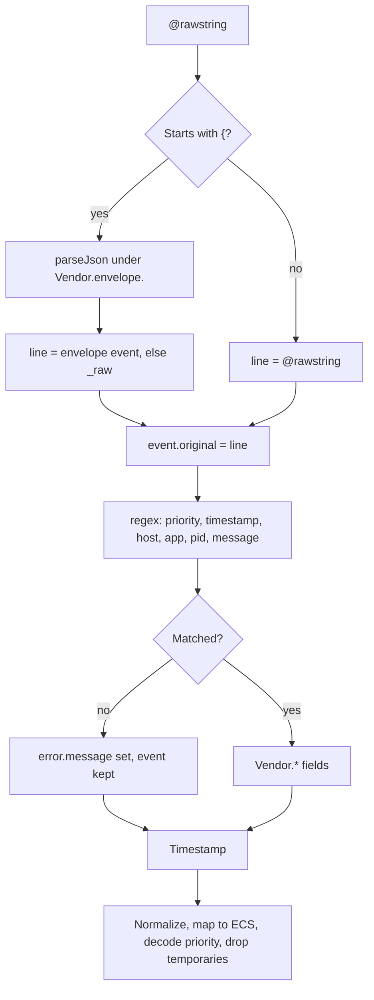

# 03 - Parser walkthrough: cribl-datagen-syslog

File: `config/parsers/cribl-datagen-syslog.cql`. On 2026-10-12 the project owner confirmed that the exact CQL committed on main was tested successfully in a working environment. This is owner-reported validation; sanitized test evidence and coverage should be recorded separately. Parser.version is a release label, not proof of validation.

## Flow



## Decisions

| Decision | Reason |
|---|---|
| Handle both wrapped and bare input | Cribl's destination wraps events. Whether the connector unwraps first was not certain, and the failure is silent: events arrive, nothing extracts |
| Envelope fields under `Vendor.envelope.` | In 1.0.0 the envelope's `host` landed in `Vendor.host`. A line the regex rejected then kept the forwarder's name as `host.name`, which is wrong data, not missing data |
| `strict="false"` plus an explicit flag | The bare `@rawstring = /.../` form is a filter and drops non-matching events. Dropping hides a broken source. The event is kept and carries `error.message` |
| Envelope epoch preferred over the line's own time | RFC3164 has no year or zone. Cribl's epoch is absolute. Trade-off: it is the time Cribl assigned, which can differ from the time the device logged. For a source with trustworthy zone and year, prefer the line |
| `MMM [ ]d HH:mm:ss` | Pads days 1 to 9 with a second space. A plain `d` fails on exactly those days, a bug that shows only on the first nine days of each month |
| Absent, not empty | Optional parts (priority, pid) produce no field when missing. Empty strings break `field=*` checks and population statistics |
| `event.dataset := syslog.generic` | Module 01 requires `#event.dataset` as `module.dataset` |
| `event.category` host, `event.type` info | Placeholders for a generic test feed. A real source sets them from the content |

## Changes from 1.0.0

| Defect in 1.0.0 | Effect | Fix | Locked by case |
|---|---|---|---|
| No `event.dataset` | Missing tag required by module 01 | Added | `test_static_metadata_complete` |
| `event.original` set before unwrapping | Held the envelope, not the log line | Set after unwrapping | `wrapped-envelope` |
| Envelope `host` stored in `Vendor.host` | Wrong `host.name` on non-matching lines | Separate `Vendor.envelope.` prefix | `wrapped-no-match-no-stale-host` |
| `Vendor.event` kept | Same event stored three times | Dropped after use | `wrapped-envelope` |
| No flag on regex failure | Unparsed events looked healthy | `error.message` | `rfc5424-not-supported` |
| Priority parsed, never used | Severity unavailable for filtering | Facility and severity decoded | `plain-rfc3164`, `priority-zero` |

## Known limitations

| Limitation | Case that pins it | Consequence |
|---|---|---|
| No year in RFC3164 | `test_year_rollover_hazard_is_real` | The Python model assumes the ingest year and can place December records in the future. LogScale documents previous-year inference for dates more than eight days ahead. This model fixture does not establish platform behavior |
| Zone assumed UTC | none | Wrong by the sender's offset if it logs local time. Confirm the sender |
| Tags with a colon, such as `pam_unix(sshd:auth)`, split wrongly | `known-limitation-pam-tag` | `process.name` becomes `pam_unix(sshd`. The Linux auth parser must handle this form |
| RFC5424 not supported | `rfc5424-not-supported` | Flagged, falls back to ingest time |
| Any three letters accepted as a month | `invalid-month-name` | Surfaces as `@error`, with no `@timestamp` from the line |

## How it is tested

`scripts/parser_ref.py` reads the CQL file, takes the regex and the static metadata from it, and models the rest in Python. `sample-data/datagen-syslog-cases.json` holds 16 inputs with the fields that must and must not be produced. Tests also pin the validated regex, the section order, the dropped fields and the agreement with module 01's tag list, and require every mapped field to be asserted by a case.

Try it:

```bash
python3 scripts/parser_ref.py '<13>Sep  9 03:04:05 db02 cron[77]: job ran'
```

## Validation coverage

The owner confirms the current CQL works in the environment. The Python model does not execute LogScale. Record whether the environment test covered each item below; successful execution does not by itself establish edge-case coverage or full CPS compliance:

- `parseTimestamp` with `format="seconds"` on a fractional epoch
- The year assumed for a time with no year
- The priority block and field typing, including priority boundary cases
- The `Vendor` and `observer.type` values against the current vendor and allowed lists
- That the tag fields selected in the parser settings match `tag_fields`

Keep the confirmed working CQL unchanged. Record test inputs, outputs, environment date and scope. Compare `Cps.version` with the published standard separately; the declared standard does not control whether the parser executes.

Reference: [timestamp year inference](https://library.humio.com/crowdstrike-query-language/functions-parsetimestamp.html).
