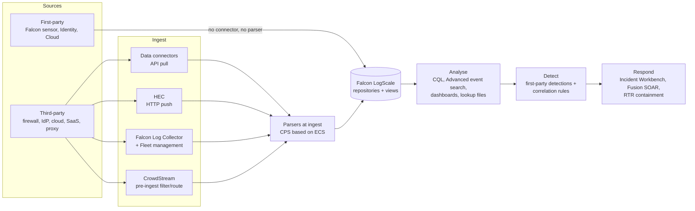

# 02 - Data flow

## End-to-end flow

A static copy of this diagram is in `diagrams/data-flow.svg`.

## Stage by stage

| Stage | What happens | Northwind Labs choice |
|---|---|---|
| Sources | First-party data is already in the platform. Third-party data must be brought in. | 9 third-party sources (see `03-sizing.md`) |
| Ingest | Connectors pull from vendor APIs; HEC receives pushed data; Falcon Log Collector runs on the customer network and is managed through Fleet management; CrowdStream is a Cribl-powered pipeline that filters and routes data before ingest. | Connectors for SaaS/cloud/identity; Falcon Log Collector for syslog and Windows/Linux logs; HEC for Zscaler; CrowdStream for high-volume firewall traffic |
| Parse | Parsers run at ingest and follow CPS (based on ECS). Out-of-the-box parsers ship in packages; you can clone, write or AI-generate parsers. | Out-of-the-box parsers first; custom only where none exists |
| Store | Events are written to repositories, each with its own retention. Views span repositories. | 6 third-party repositories (see `04-retention-and-repositories.md`) |
| Analyse | CQL in Advanced event search, dashboards, lookup files. | Single search surface via `view-soc-all` |
| Detect | First-party detections come from Falcon; correlation rules run CQL on a schedule against any data. | Correlation rules over third-party repositories |
| Respond | Incident Workbench for investigation, Fusion SOAR workflows, RTR/host containment, API clients with scopes. | Fusion workflow contains a host after a high-confidence identity or network alert |

## Per-source ingest path

| ID | Source | Path | Why this path |
|---|---|---|---|
| SRC-01 | Okta SSO | Data connector (API pull) | Native API, no infrastructure to run |
| SRC-02 | Microsoft Entra ID | Data connector (API pull) | Same |
| SRC-03 | Microsoft 365 audit | Data connector (API pull) | Same |
| SRC-04 | AWS CloudTrail | Data connector (API pull) | Same |
| SRC-05 | FortiGate traffic | CrowdStream filter, then NG-SIEM | Highest volume; filter noise before it counts against ingest |
| SRC-06 | FortiGate UTM/event | Falcon Log Collector (syslog) | Low volume, syslog source on the network |
| SRC-07 | Zscaler Internet Access | HEC (push) | Vendor pushes events over HTTPS |
| SRC-08 | Windows Security (DCs) | Falcon Log Collector (Windows events) | Agent-based collection on domain controllers |
| SRC-09 | Linux auth/syslog | Falcon Log Collector (file/syslog) | Same |

## Time fields and delivery health

Every event carries built-in fields that the architecture relies on:

| Field | Meaning |
|---|---|
| `@rawstring` | Original log line exactly as received |
| `@timestamp` | Event time, taken by the parser from the log itself |
| `@ingesttimestamp` | When NG-SIEM received the event |

If a parser does not set `@timestamp`, LogScale uses the ingest time. A large gap between `@timestamp` and `@ingesttimestamp` indicates delayed delivery (collector backlog or outage), a parser reading the wrong time zone, or a wrong clock on the source device. A gap of roughly zero on every event suggests the parser may not be setting `@timestamp` at all. This gap is the basis of the delivery-health checks in `ngsiem-collector-fleet-health`.

## Important constraint: no re-parsing

LogScale cannot re-parse data once it is stored. The only fix for incorrectly parsed old events is to re-ingest them from `@rawstring`. This is why parsers are validated against sample data before a source goes live (see `ngsiem-data-onboarding`).

## How a search stays fast

1. The time range selects which segments are read.
2. Tags select which datasources are read.
3. Hash filters (bloom-filter based) let the search skip segments that cannot contain the search term.

Design consequence: choose tags that match how analysts filter (vendor, module, dataset), and keep searches to the smallest time window that answers the question. Recent data sits on fast local disk and older data in object storage, so searches over old data are slower.
